<div align="center">


<br/>

[](https://yating021.github.io/interactive_tech_tutor/)
[](https://itt-api.orangefield-ee93915e.koreacentral.azurecontainerapps.io/health)

[](https://github.com/YatinG021/interactive_tech_tutor/actions/workflows/deploy-backend.yml)
[](https://github.com/YatinG021/interactive_tech_tutor/actions/workflows/deploy-frontend.yml)


**Type any technical topic and watch it explained as a narrated, animated, step-by-step simulation.**<br/>
Steer it with your voice, ask a tutor follow-up questions, and pass a quiz at each of three levels.

</div>

---

## Contents

- [Features](#features)
- [Screenshots](#screenshots)
- [Architecture](#architecture)
- [Simulation pipeline](#simulation-pipeline)
- [Request lifecycle](#request-lifecycle)
- [CI/CD pipeline](#cicd-pipeline)
- [Design system and motion](#design-system-and-motion)
- [Tech stack](#tech-stack)
- [Repository structure](#repository-structure)
- [Getting started](#getting-started)
- [Configuration](#configuration)
- [Project phases](#project-phases)
- [Documentation](#documentation)

## Features

| | |
|---|---|
| 🎬 **Generated simulations** | Any topic becomes 6–8 animated diagram steps with narration and subtitles. About 20–40 s the first time, instant afterwards (shared cache). |
| 🧭 **Curated lessons** | Five hand-built simulations with exact diagrams and topic-specific quizzes. |
| 🗣️ **Natural narration** | A human-sounding Sarvam Bulbul voice reads every step; each sentence is synthesised once and cached. Browser voice as fallback. |
| 🎙️ **Voice control** | "Next", "go back", "go to step 3", "pause", "move the resolver to the right". |
| 💬 **Tutor chat** | Short, concrete, on-topic answers by text or voice. |
| 🏆 **Practice and progress** | Beginner, intermediate and advanced quizzes; passing one level unlocks the next. |
| ⌨️ **Accessible** | Keyboard shortcuts, subtitles that work with narration muted, reduced-motion support. |

### Curated simulations

| Lesson | Subject | Difficulty |
|---|---|---|
| Binary search | Data structures & algorithms | 🟢 Easy |
| Binary search trees (search, insert, delete) | Data structures & algorithms | 🟡 Medium |
| Dijkstra's shortest path | Data structures & algorithms | 🔴 Hard |
| The TLS 1.3 handshake | Computer networks & security | 🟡 Medium |
| Virtual memory and address translation | Operating systems | 🔴 Hard |

## Screenshots

<table>
  <tr>
    <td width="50%">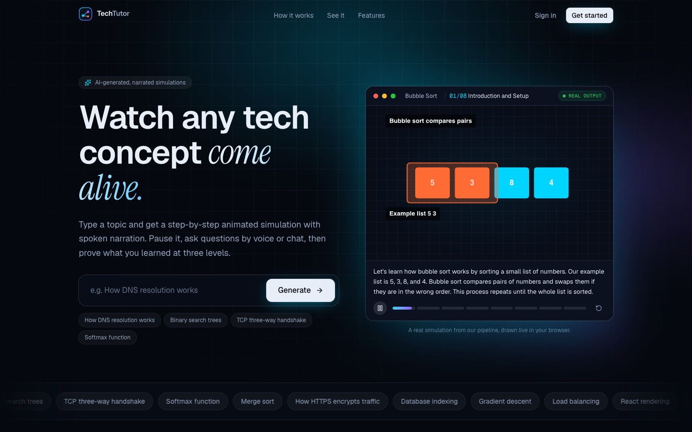<br/><sub><b>Landing</b>: a real generated simulation playing live in the hero</sub></td>
    <td width="50%">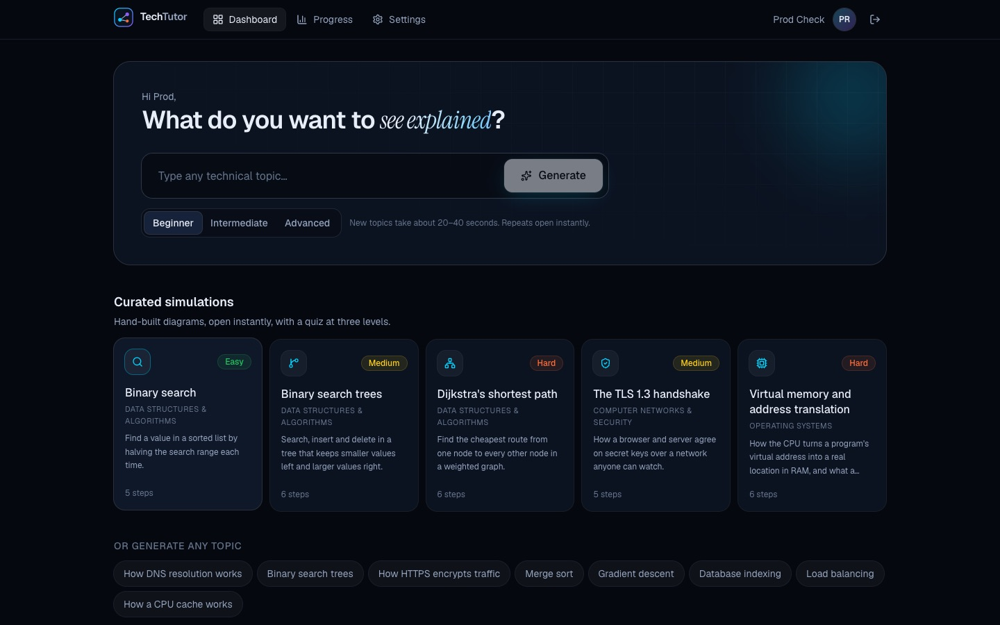<br/><sub><b>Dashboard</b>: generate any topic or open a curated lesson</sub></td>
  </tr>
  <tr>
    <td>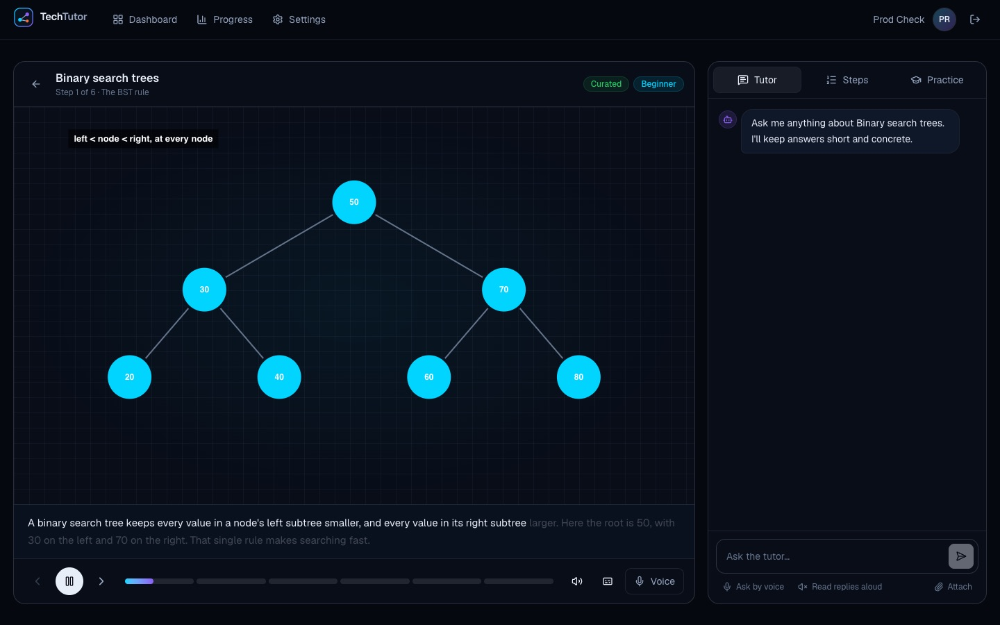<br/><sub><b>Player</b>: canvas, narration, subtitles and the tutor side panel</sub></td>
    <td>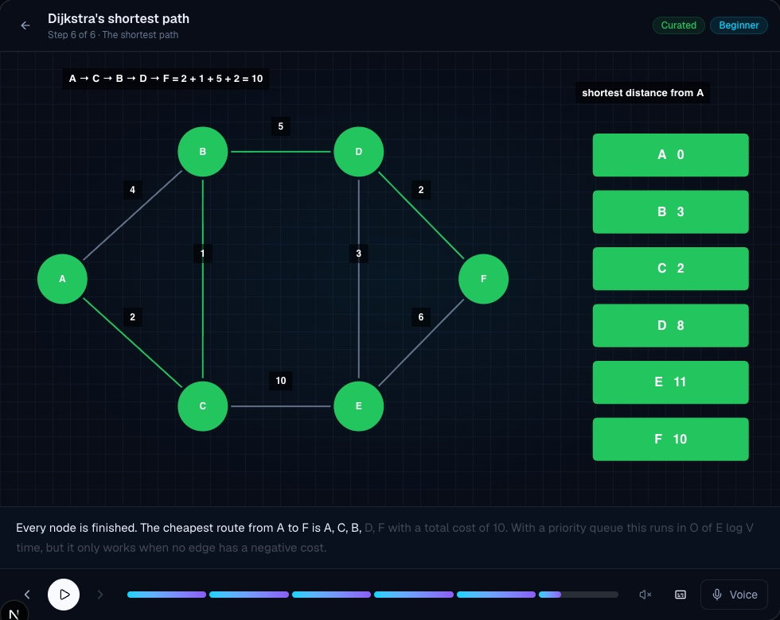<br/><sub><b>Dijkstra</b>: visited set, relaxed edges and the final path</sub></td>
  </tr>
  <tr>
    <td>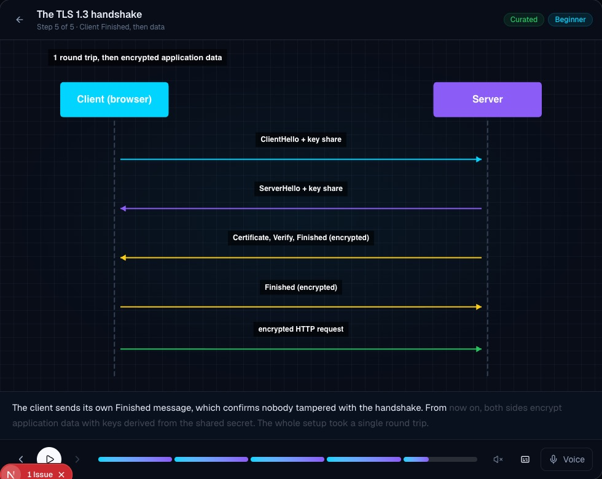<br/><sub><b>TLS 1.3</b>: one round trip, message by message</sub></td>
    <td>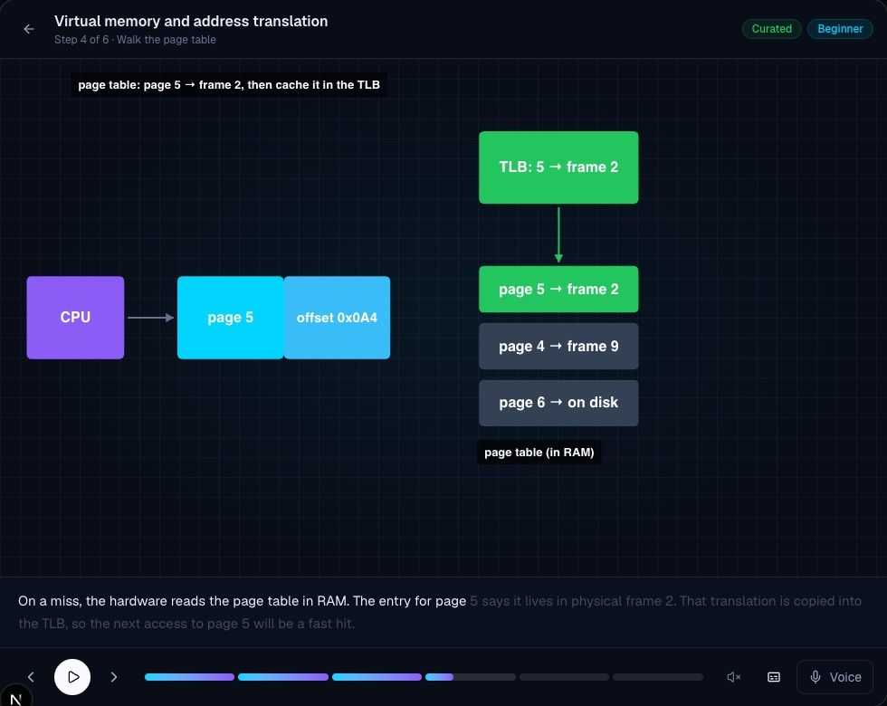<br/><sub><b>Virtual memory</b>: TLB miss, page-table walk, page fault</sub></td>
  </tr>
</table>

## Architecture

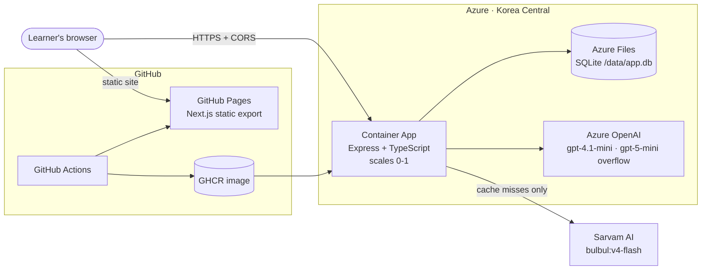

- **Frontend** is a static export, so GitHub Pages hosts it for free. All pages are client pages that call the API.
- **API** runs on Azure Container Apps and scales to zero when idle; one replica keeps SQLite safe on the network share.
- **One SQLite file** holds users, sessions, preferences, progress, history, the simulation cache and the narration-audio cache.
- **Secrets** (JWT, Azure OpenAI, Sarvam) are Container App secrets; locally they live in gitignored `.env` files.

Details: [docs/architecture.md](docs/architecture.md).

## Simulation pipeline


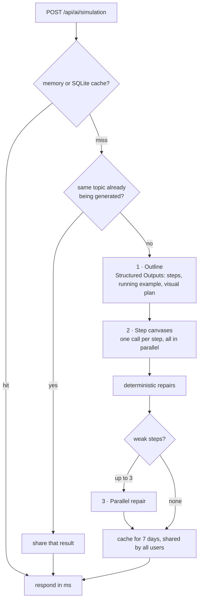

| | Before (AWS) | Now (Azure) |
|---|---|---|
| Cold simulation | 3 serial passes (42 s for the first pass alone) | about 20 s |
| Repeat topic | regenerated | ≈0.01 s from cache |
| 4 simultaneous users | — | 18–45 s, no errors |

Diagrams are data: shapes carry ids and connectors reference them (`from`/`to`), so the renderer attaches every arrow to the outlines of the shapes it joins.

## Request lifecycle

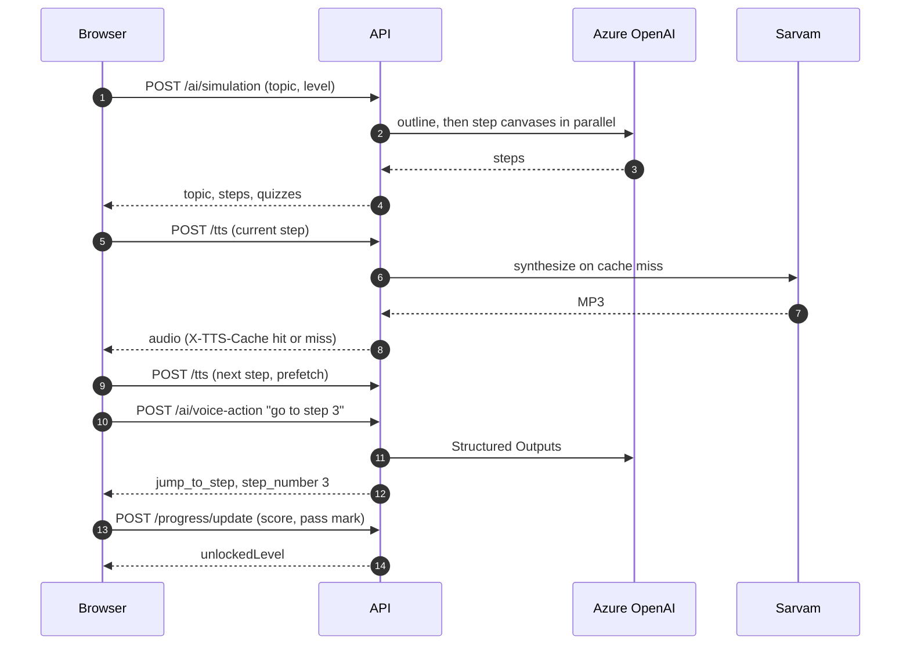

## CI/CD pipeline

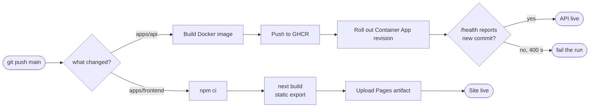

## Design system and motion

| Token | Value | Use |
|---|---|---|
| Ink | `#05080f` → `#22304d` | Dark, quiet chrome so diagrams stand out |
| Cyan | `#00d4ff` | Primary accent, progress, focus |
| Violet | `#8b5cf6` | Tutor and AI |
| Signal | `#ff6b35` | The element being discussed, listening, errors |
| Mint / Amber | `#22c55e` / `#facc15` | Success / warning |
| Type | Geist · Geist Mono · *Instrument Serif* accents | UI · counters · headline emphasis |

**Motion principles**
- One easing curve, `cubic-bezier(0.22, 1, 0.36, 1)`; springs for tabs, toggles and badges.
- Entrances fade and rise 12–24 px with 60–100 ms staggers; scroll reveals play once.
- Landing "videos" are real pipeline output drawn live by the app's renderer, plus motion-graphic scenes for voice, tutor and practice. Players pause off-screen.
- Subtitles reveal word by word with narration; connectors draw only after the shapes they join appear.
- Everything respects `prefers-reduced-motion`.

The full product and design spec is in [docs/ui-ux-prompt.md](docs/ui-ux-prompt.md).

## Tech stack

| Layer | Technology |
|---|---|
| Frontend | Next.js 16 (App Router, static export), React 19, TypeScript, Tailwind CSS 4, Motion, Lucide icons |
| Simulation rendering | Custom 2D canvas renderer with shape-anchored connectors and tree layout |
| Backend | Node.js 22, Express 4, TypeScript, zod, JSON Web Tokens, scrypt |
| Data | SQLite (better-sqlite3) on an Azure Files share |
| AI | Azure OpenAI in Microsoft Foundry: gpt-4.1-mini (primary), gpt-5-mini (overflow), Structured Outputs |
| Voice | Sarvam AI `bulbul:v4-flash` text-to-speech; Web Speech API for recognition and fallback narration |
| Hosting | GitHub Pages (frontend), Azure Container Apps (API), GitHub Container Registry (image) |
| CI/CD | GitHub Actions with a post-deploy health check |

## Repository structure

```
.
├── apps/
│   ├── api/                  Express API · Dockerfile · .env.example
│   │   └── src/
│   │       ├── index.ts      routes and the simulation pipeline
│   │       ├── auth.ts       passwords, tokens, sessions
│   │       ├── db/           SQLite schema and seed content
│   │       ├── services/     Azure OpenAI client, prompts, Sarvam TTS
│   │       └── scripts/      backup export and import
│   └── frontend/             Next.js app · own node_modules · .env.example
│       └── src/
│           ├── app/          routes
│           ├── components/   landing, app shell, learn player, UI
│           ├── lib/          API client, auth, narration, renderer
│           └── data/         curated simulations and landing demos
├── docs/                     architecture, operations, API reference, phases, assets
├── scripts/                  rotate-sarvam-key.sh
└── .github/workflows/        deploy-backend.yml · deploy-frontend.yml
```

## Getting started

**Requirements:** Node.js 22+, an Azure OpenAI deployment; a Sarvam API key is optional.

```bash
git clone https://github.com/YatinG021/interactive_tech_tutor.git
cd interactive_tech_tutor

npm install                                  # API (root workspace)
npm --prefix apps/frontend install           # frontend (separate node_modules)

cp apps/api/.env.example apps/api/.env                 # fill in your keys
cp apps/frontend/.env.example apps/frontend/.env.local

npm run dev:api                              # http://localhost:4000
npm run dev:frontend                         # http://localhost:3000
```

## Configuration

All `.env` files are gitignored; each app ships a `.env.example`.

| `apps/api/.env` | Purpose |
|---|---|
| `AZURE_OPENAI_ENDPOINT`, `AZURE_OPENAI_API_KEY`, `AZURE_OPENAI_DEPLOYMENT` | Language model (required for AI features) |
| `AZURE_OPENAI_OVERFLOW_DEPLOYMENT` | Second deployment used on rate limits or outages |
| `SARVAM_API_KEY`, `SARVAM_TTS_MODEL`, `SARVAM_TTS_SPEAKER`, `TTS_DAILY_CHAR_LIMIT` | Natural narration |
| `JWT_SECRET` | Token signing (required in production) |
| `DATA_DIR` | Where `app.db` lives (`/data` in Azure) |
| `FRONTEND_ORIGINS` | Allowed browser origins |

| `apps/frontend/.env.local` | Purpose |
|---|---|
| `NEXT_PUBLIC_API_URL` | API base URL including `/api` |
| `NEXT_PUBLIC_BASE_PATH` | `/<repo>` on GitHub Pages, empty locally |

## Project phases

The migration from AWS to Azure and the rebuild of the frontend, documented step by step:

| Phase | | Outcome |
|---|---|---|
| 0 | [Assessment and plan](docs/phases/00-assessment-and-plan.md) | Requirements, AWS inventory, Azure target |
| 1 | [Azure foundation](docs/phases/01-azure-foundation.md) | Subscription, region policy, Azure OpenAI, repository move |
| 2 | [Language model](docs/phases/02-language-model.md) | Bedrock → Azure OpenAI |
| 3–4 | [Storage and pipeline](docs/phases/03-04-storage-and-pipeline.md) | DynamoDB + S3 → SQLite, parallel generation, new prompts |
| 5 | [Backend deployment](docs/phases/05-backend-deployment.md) | Container Apps, Azure Files, CI/CD |
| 6 | [Frontend](docs/phases/06-frontend.md) | Next.js on GitHub Pages, curated lessons, aligned diagrams, Sarvam voice |
| 7 | [Cleanup](docs/phases/07-cleanup.md) | Old app and AWS-era config removed, repository restructured |

## Documentation

| | |
|---|---|
| [Architecture](docs/architecture.md) | System design, data model, pipeline, renderer |
| [API reference](docs/api-reference.md) | Every endpoint with request and response shapes |
| [Backend setup](docs/backend-setup.md) | Environment variables, data layout, production checklist |
| [Operations](docs/operations.md) | Deployments, secrets and key rotation, costs, teardown |
| [UI/UX spec](docs/ui-ux-prompt.md) | Product and design specification |

## License

See [LICENSE](LICENSE).
