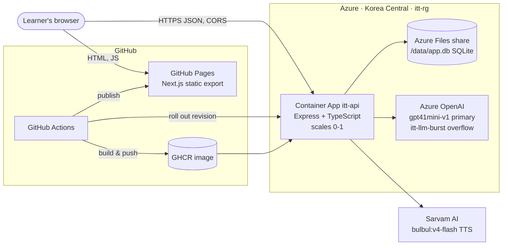
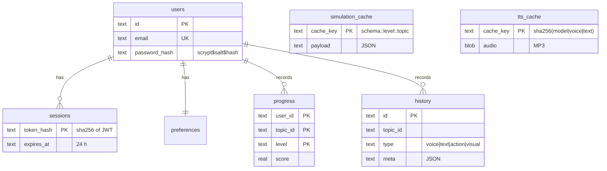
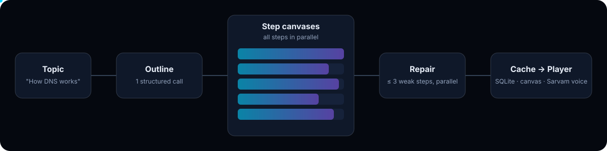
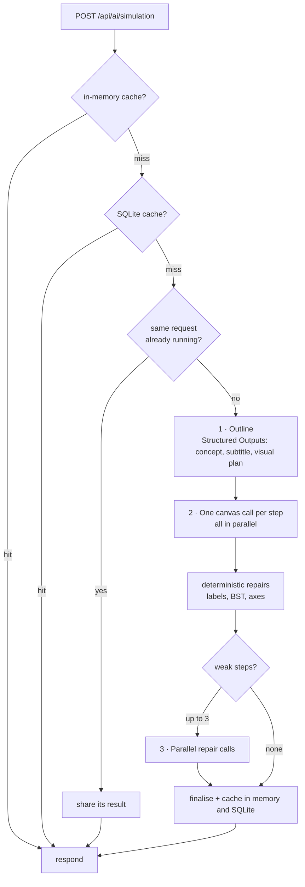
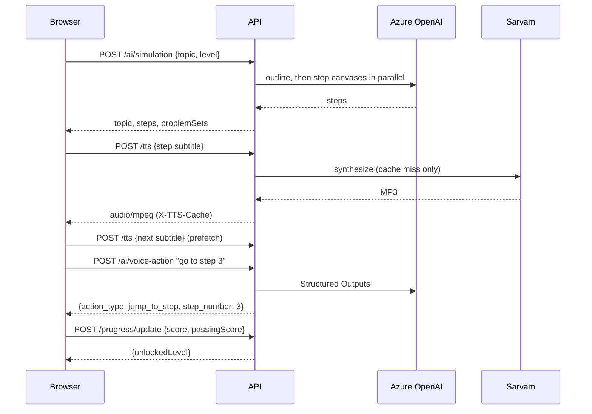

# Architecture

## System overview



| Component | Technology | Why |
|---|---|---|
| Frontend | Next.js 16, React 19, Tailwind 4, Motion | Static export, so it hosts free on GitHub Pages |
| API | Express 4, TypeScript, zod | One small service with a clear REST contract |
| Data | SQLite (better-sqlite3) on Azure Files | One file, no database server; survives restarts and scale-to-zero |
| LLM | Azure OpenAI, gpt-4.1-mini plus gpt-5-mini overflow | Fast structured JSON; overflow absorbs rate limits |
| Voice | Sarvam bulbul:v4-flash, browser `speechSynthesis` fallback | Human-sounding narration, cached per sentence |
| Hosting | Azure Container Apps (WorkloadProfiles, Consumption) | Scales to zero; supports Azure Files mounts |

SQLite on a network share needs one writer, so the app runs **one replica** in **single-revision** mode, with the share mounted `nobrl` and the default rollback journal (WAL does not work on SMB).

## Repository layout

```
.
├── apps/
│   ├── api/                    Express API (root npm workspace)
│   │   ├── src/
│   │   │   ├── index.ts        server, routes, simulation pipeline
│   │   │   ├── auth.ts         scrypt passwords, JWT, hashed sessions
│   │   │   ├── types.ts
│   │   │   ├── db/             SQLite schema + repositories, seed content
│   │   │   ├── services/       llm.ts, prompts.ts, tts.ts
│   │   │   └── scripts/        backup export / import
│   │   ├── data/               runtime SQLite file (gitignored)
│   │   ├── Dockerfile
│   │   └── .env.example
│   └── frontend/               Next.js app (own node_modules and lockfile)
│       ├── src/app/            routes: / login signup dashboard learn progress settings
│       ├── src/components/     landing, app shell, learn player, UI primitives
│       ├── src/lib/            api client, auth, narration, speech, player, renderer
│       ├── src/data/           curated simulations, landing demos
│       └── .env.example
├── docs/                       this documentation
├── scripts/                    operational scripts (key rotation)
└── .github/workflows/          deploy-backend.yml, deploy-frontend.yml
```

## Data model



## Simulation generation pipeline





- A cold topic takes about 20–40 s; a cached one returns in milliseconds and is shared by every user for 7 days.
- A process-wide limiter caps concurrent model calls. On a 429 or 5xx the client switches to the overflow deployment.
- If the model is unavailable the API returns a template simulation (`generationSource: "template"`), which is never cached.

## Request flow: learning a topic



## The canvas renderer

Simulations are data: each step is a list of elements (`rectangle`, `circle`, `bar`, `tree_node`, `arrow`, `matrix`, …) with percentage coordinates and animations. `apps/frontend/src/lib/simulation/renderer.ts` draws them on a 2D canvas.

- **Connectors attach to shapes.** An arrow names its endpoints (`from`/`to` element ids); the renderer computes where the line meets each shape's outline every frame, so diagrams stay connected at any canvas size. Unnamed endpoints near a shape snap to it.
- **Connectors wait for their shapes**: an arrow's draw animation starts once both endpoints are visible.
- **Trees lay themselves out.** `tree_node` elements form a BST by value and draw their own edges.
- **Clamping keeps shapes on-canvas without moving shapes that already fit.**

Curated simulations are authored with `src/lib/simulation/compose.ts` helpers (`box`, `node`, `link`, `cellRow`, `arrowAt`), which produce exact geometry with ids.

## Frontend design system

| Token | Value | Use |
|---|---|---|
| ink-950 … ink-600 | `#05080f` … `#22304d` | Page, panels, cards, raised surfaces |
| cyan | `#00d4ff` | Primary accent, progress, focus |
| violet | `#8b5cf6` | Tutor and AI |
| signal | `#ff6b35` | Active element, listening, errors |
| mint / amber | `#22c55e` / `#facc15` | Success / warning |
| Type | Geist, Geist Mono, Instrument Serif italic accents | UI, counters, headline emphasis |

Motion uses an expo-out ease (`cubic-bezier(0.22, 1, 0.36, 1)`), springs for toggles and tabs, scroll reveals that play once, and players that pause off-screen. Everything respects `prefers-reduced-motion`.
